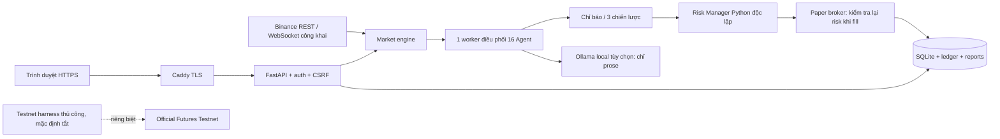

# AI Trading Command Center — Private Cloud Website

Website tự lưu trữ: mở bằng trình duyệt, không cần cài ứng dụng Windows.
Backend FastAPI + SQLite, 16 vai trò Agent chạy trong một worker, dashboard
Three.js/2D, ba chiến lược, backtest và tài khoản **paper**.

**Bắt đầu tại [HƯỚNG DẪN CLOUD](docs/CLOUD_DEPLOY.md).** Toàn bộ thao tác cài
đặt chạy trên máy chủ qua web console của nhà cung cấp, không phải trên PC.

**Chỉ dùng một mình, không mua tên miền:** chọn
[truy cập riêng bằng Tailscale](docs/PRIVATE_ACCESS.md) với
`compose.private.yaml`. Backend chỉ mở loopback VPS, HTTPS do Tailscale
Serve cung cấp; vẫn giữ đăng nhập và CSRF. Phương án này cần Tailscale trên
thiết bị truy cập và VPS, không bật Funnel/public website.

## Phạm vi bản giao

| Giai đoạn | Mã nguồn có trong bản này | Bằng chứng / giới hạn |
|---|---|---|
| 1 Foundation | FastAPI, SQLite, config, tests | Đã chạy |
| 2 Market | REST/WS Binance, nến 4 khung, trades, top-20 book, stale/reconnect | Offline/socket tests đạt; Binance trả HTTP 451 từ cloud hiện tại |
| 3 Agents | 16 vai trò, dependency graph, persistent queue, quyền tools, retry/recovery | Đã chạy chu kỳ HTTP; Ollama thật chưa thử |
| 4 Trading | RSI/MACD/EMA/BB/ATR, 3 strategies, risk, backtest/holdout, paper ledger | Đã kiểm thử bằng fixtures; chưa có kết quả trading thực tế |
| 5 Testnet | Adapter riêng: signed REST, query/cancel/modify, algo SL/TP params, durable intent/reconcile | Chưa có key hoặc chứng nhận sàn; không nối vào web/auto execution |
| 6 Interface | Văn phòng 3D 7 phòng/16 avatar, trạng thái, 2D fallback, chart EMA, mobile | Chromium desktop/mobile và WebGL software test |
| 7 Operations | Hosted login/CSRF, Docker/Caddy, backup, retention, báo cáo giờ/ngày/tuần | Tests + container smoke; chưa gắn domain/cấp TLS công khai |

Bản này **không có đường gửi lệnh production**. `ATC_MODE` chỉ chấp nhận
paper. `/api/orders` luôn từ chối. Không thể coi phase 5 đã nghiệm thu chỉ
vì code adapter hoặc mock tests đạt. Không có cam kết lợi nhuận.

## Kiến trúc



Cloud nhỏ chỉ cần Python và browser UI. Ollama mặc định tắt: các Agent là
vai trò với tools/prompt/quyền riêng, không phải 16 mô hình đang chạy.
Không cần GPU hay API AI trả phí. Three.js được vendored từ npm, xác minh
SHA-512; runtime không phụ thuộc CDN. Nguồn/license trong `app/static/vendor`.

## Chiến lược và Risk

Chi tiết điều kiện LONG/SHORT/HOLD, entry/exit, chi phí và giả định tại
[TRADING.md](docs/TRADING.md). Risk kiểm tra độc lập freshness, Kill Switch,
rủi ro 0.5%, daily loss 2%, drawdown 10%, tối đa 3 vị thế, exposure 1× equity,
leverage tối đa 2, quantity/price filters và stop geometry. Không tự tăng
khối lượng sau thua hoặc bình quân giá xuống. LLM không đổi được giới hạn.
Liquidation buffer hiện là mô hình paper bảo thủ, không thay liquidation
price/brackets được sàn xác nhận.

Khởi động lại hoặc lỗi nghiêm trọng luôn bật Kill Switch. Đóng vị thế
paper theo stop/target vẫn chạy khi Kill Switch bật. Chỉ chủ website có thể
bật quyền paper sau khi thị trường fresh; không mở được quyền tiền thật.

## API sử dụng qua website

- Market và chart: `/api/market`, `/api/candles/{symbol}?interval=5m`.
- Agents: POST `/api/agent-cycles`, GET `/api/agent-cycles/{id}`.
- Strategies/backtest: `/api/strategies/{symbol}`, POST `/api/backtests`.
- Paper: `/api/portfolio`, `/api/ledger`, `/api/performance`, POST `/api/paper/arm`, POST `/api/paper/run`.
- Reports: `/api/reports`; tải JSON ngay trong dashboard.
- Safety: POST `/api/kill-switch`; không có API nâng risk limits.

Trong hosted mode mọi dữ liệu nghiệp vụ đều yêu cầu đăng nhập; mutations
cần cookie session, Origin đúng và CSRF header. Website tự xử lý các bước này.

## Công cụ vận hành trên server

```bash
python -m app.ops hash-password
python -m app.ops backup data/command_center.sqlite3 /tmp/command-center-backup.sqlite3
python -m app.ops check-backup /tmp/command-center-backup.sqlite3
python -m app.market.probe --timeout 90
python -m app.execution.testnet
```

Hai probe cuối có thể exit 1 do thiếu truy cập/credentials; không gọi là
đạt nghiệm thu nếu chúng chưa pass. Testnet probe chỉ đọc, không đặt lệnh.

## Phát triển và kiểm thử (không cần cho người chỉ dùng web)

Từ gốc dự án, Python 3.12:

```bash
python3 -m venv .venv
.venv/bin/python -m pip install -r requirements.lock.txt
.venv/bin/python -m pytest -q
.venv/bin/python -m uvicorn app.main:app --host 127.0.0.1 --port 8000
```

Cấu hình mặc định local-only. Đưa lên Internet phải dùng hosted mode theo
CLOUD_DEPLOY.md; không đơn thuần đổi bind address của cấu hình local.
File `.env.example` dành cho development, `deploy/cloud.env.example` dành
cho website. Không ghi đè `.env` hoặc DB cũ khi cập nhật.

Các tài liệu PHASE2/PHASE3 là lịch sử từng giai đoạn. Tài liệu bản cuối
README/CLOUD_DEPLOY/TRADING/ACCEPTANCE có ưu tiên khi thông tin khác nhau.
Cây thư mục đầy đủ tại [FILES.md](docs/FILES.md).
