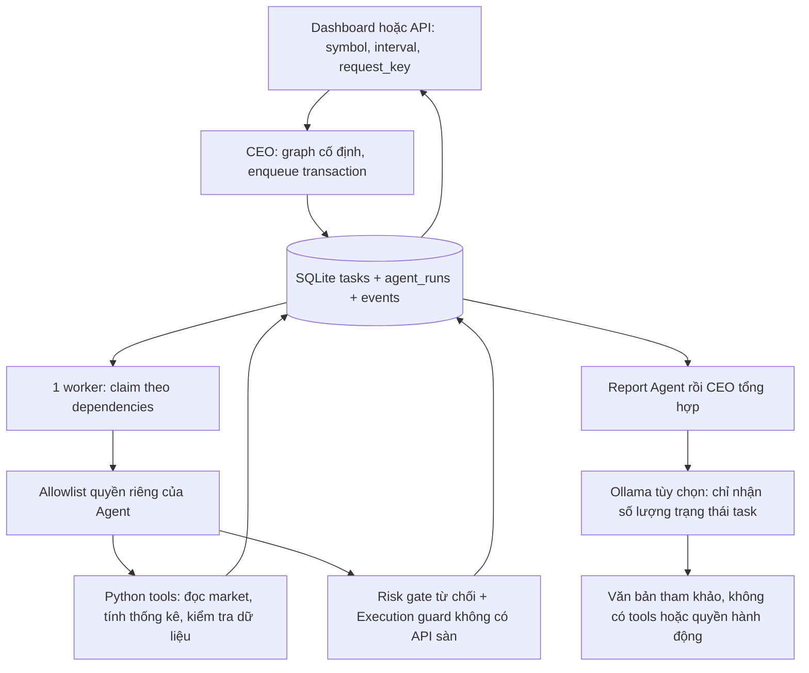

# Giai đoạn 3 — Điều phối 16 Agent

## Kiến trúc đã triển khai

Một backend, một worker async chạy tuần tự, một hàng đợi bền vững SQLite.
Không tạo 16 tiến trình LLM. CEO nhận yêu cầu **chạy chu kỳ phân tích** từ
dashboard hoặc API, xếp 16 nhiệm vụ theo graph cố định và tổng hợp bằng
chứng. Chưa có chatbot tự do hoặc LLM tự lập kế hoạch/cấp quyền.

Mỗi nhiệm vụ có UUID, run ID, Agent, tool, input có schema, dependencies,
created/started/finished time UTC, attempts, trạng thái, kết quả và events.
Các prompt/vai trò của 16 Agent ở `app/agents.py`; allowlist công cụ được
kiểm tra trong `Tools.dispatch`. Không có API chọn tùy ý tool, sửa prompt,
thay risk hoặc gửi lệnh theo nội dung LLM.



Luồng phụ thuộc:

1. Monitor và Security kiểm tra DB, freshness, cấu hình.
2. Market → Technical + Data; News chạy độc lập.
3. Technical + Data + News → Strategy → Signal → Risk → Execution.
4. Execution → Portfolio → Accounting → Performance.
5. Strategy → Backtest; Performance + Backtest → Report → CEO.

Dependency ở Waiting/Error là đã kết thúc lần thử hiện tại, cho phép
downstream **báo thiếu điều kiện hoặc từ chối**, không có nghĩa là được
duyệt giao dịch. Risk luôn `approved=false`; Execution luôn `sent=false`.
Phase 4 mới triển khai Risk Manager/sizing/liquidation đầy đủ.

## Khả năng thực tế của từng vai trò

| Agent | Công việc phase 3 |
|---|---|
| CEO | Xếp graph cố định, tổng hợp task counts và ID bằng chứng; Ollama optional |
| Market Analyst | Đọc giá và event age khi toàn bộ nguồn market đủ mới |
| Technical Analyst | SMA20, close, thay đổi giá trên 20 nến đóng bằng Decimal |
| News Analyst | Waiting: chưa có provider tin tức |
| Data Analyst | Kiểm tra số nến, khoảng trống và freshness |
| Strategy Agent | Waiting: chưa có 3 strategy engines đã kiểm thử |
| Signal Agent | HOLD không actionable do thiếu strategy engine |
| Risk Manager | Gate xác định từ chối; không có LLM override |
| Execution Agent | Guard từ chối; không tồn tại exchange execution client |
| Portfolio Agent | Waiting: chưa kết nối tài khoản hoặc paper portfolio |
| Accounting Agent | Waiting: chưa có fill ledger, phí/funding/PnL |
| Performance Agent | Waiting: chưa có lịch sử giao dịch được xác minh |
| System Monitor | Kiểm tra DB/market và giữ Kill Switch khi market không fresh |
| Backtest Agent | Waiting: chưa có backtest engine, không tạo kết quả giả |
| Report Agent | Tổng hợp các nhiệm vụ đã kết thúc và evidence task IDs |
| Security Agent | Kiểm tra cấu hình mode, risk mutation API và quyền model tools |

Security Agent chỉ là kiểm tra cấu hình ở phase này, không thay thế audit
toàn hệ thống. Chưa có full RSI/MACD/EMA/BB/ATR, position sizing hay lệnh
giao dịch. Thống kê kỹ thuật từ cache được đánh Waiting khi market stale.

## Trạng thái, retry và restart

- Task: Pending → Working/Thinking → Completed, Waiting hoặc Error.
- Waiting có kết quả/giải thích và finished time; không được đếm là thành
  công giao dịch. Muốn kiểm tra lại sau khi có dữ liệu: chạy chu kỳ mới.
- Agent: Idle, Working, Thinking, Waiting, Error, Offline. Pending hiển thị
  Waiting; Completed hiển thị Idle; tắt worker hiển thị Offline.
- Chu kỳ: Pending, Working, Completed hoặc CompletedWithWarnings. Warnings
  xuất hiện khi ít nhất một nhiệm vụ Waiting/Error/Cancelled; không phải
  chứng nhận strategy hoặc trading đã vượt kiểm thử.
- Timeout mặc định 45s, tối đa hai attempts; retry chỉ cho timeout hoặc
  task bị gián đoạn. Lỗi tool/permission là Error, không lặp vô hạn.
- Task Working/Thinking khi restart được phục hồi Pending nếu còn attempts;
  nếu đã hết thì Error. Chỉ task read-only được tự chạy lại; lệnh sàn chưa
  tồn tại, không dùng cơ chế này cho execution có side effects ở phase 5.
- OS file lock theo DB ngăn hai worker dùng cùng DB. Chỉ chạy một backend,
  không dùng nhiều Uvicorn workers. File lock còn trên đĩa sau thoát là bình
  thường: khóa hệ điều hành tự giải phóng khi tiến trình kết thúc.
- Tối đa 4 chu kỳ đang hoạt động (64 nhiệm vụ), queue đầy trả 429. Chu kỳ
  kết thúc và logs vẫn được giữ để tra cứu; log retention ở phase 7.

DB tự migration thêm columns và bảng agent_runs, không xóa lịch sử phase
1–2. Nên backup `data/` khi server dừng trước khi nâng phiên bản. File
`*.agents.lock` không phải dữ liệu cần sao lưu.

## Ollama local tùy chọn

Mặc định tắt, hệ thống chạy đầy đủ orchestration bằng Python. Nếu bật,
chỉ CEO được nhờ mô hình **viết đoạn tổng kết số lượng task**, không được
truy cập tool, risk, order, env, file, tin tức hoặc secret.

POST `/api/chat` tới Ollama loopback, context 2048, tối đa 180 output tokens,
một yêu cầu mỗi lần theo worker. Response giới hạn 32KB, prose tối đa 2000
ký tự, luôn có `advisory_only=true`. Prose không được parse thành hành động.
Không có secret hoặc văn bản bên ngoài trong model input. URL Ollama chỉ
chấp nhận HTTP loopback, không follow redirect; không truyền proxy Internet
cho kết nối local. Client timeout 30s sẽ fallback tổng kết Python.

`ollama_last_request_ok` là kết quả lần gọi gần nhất, không chứng minh một
kết nối persistent hoặc model vẫn đang chạy. `llm_connected=false` được giữ
để không gắn nhãn kết nối liên tục. Chưa kiểm thử model thật trong cloud.

## File và dependencies

Thêm:

```text
app/orchestration/
├── __init__.py
├── lock.py
├── store.py
├── llm.py
├── tools.py
└── manager.py
tests/test_agents.py
docs/PHASE3.md
```

Cập nhật main/config/db, `.env.example`, dashboard và test phase 2. Giữ
nguyên thư mục module cũ. Không thêm dependency: `requirements.txt` và
`requirements.lock.txt` đã đủ cho phase này.

## Windows PowerShell — cài và chạy

Tại gốc dự án, sau khi tải phiên bản mới và dừng server cũ:

```powershell
.\.venv\Scripts\python.exe -m pip install -r requirements.lock.txt
.\.venv\Scripts\python.exe -m pytest -q
.\.venv\Scripts\python.exe -m uvicorn app.main:app --host 127.0.0.1 --port 8000
```

Nếu chưa có venv, theo README. Không ghi đè `.env` cũ. Các cấu hình mới có
mặc định, có thể thêm vào `.env`:

```dotenv
ATC_AGENTS_ENABLED=true
ATC_AGENT_TASK_TIMEOUT=45
ATC_AGENT_AUTO_SECONDS=0
ATC_OLLAMA_ENABLED=false
ATC_OLLAMA_URL=http://127.0.0.1:11434
ATC_OLLAMA_MODEL=qwen2.5:3b
```

Chạy chu kỳ thủ công trong PowerShell thứ hai:

```powershell
$cycleBody = @{
    symbol = 'BTCUSDT'
    interval = '5m'
    request_key = [guid]::NewGuid().ToString()
} | ConvertTo-Json
$cycle = Invoke-RestMethod -Method Post -Uri 'http://127.0.0.1:8000/api/agent-cycles' -ContentType 'application/json' -Body $cycleBody
Invoke-RestMethod "http://127.0.0.1:8000/api/agent-cycles/$($cycle.run_id)"
Invoke-RestMethod 'http://127.0.0.1:8000/api/agents'
```

Hoặc chọn cặp/khung trên dashboard rồi bấm “CEO: chạy chu kỳ phân tích”.
Kết quả và nhật ký cập nhật từ backend. Task nhanh có thể hoàn tất giữa
hai lần polling 2s, không kéo dài giả để biểu diễn animation.

Gửi lại **cùng `$cycleBody`** sau lỗi mạng sẽ trả cùng run ID và
`created=false`, không tạo thêm 16 task. Cùng key nhưng đổi symbol/interval
trả 409. Muốn chạy một chu kỳ mới: tạo request key mới.

Tự chạy theo lịch là tùy chọn: `ATC_AGENT_AUTO_SECONDS=60` và restart backend.
Giá trị hợp lệ 0 (tắt) hoặc 30–3600. Scheduler dùng khung 5m cho các cặp
được cấu hình; khi đầy queue thì bỏ lượt, xoay thứ tự cặp cho lượt sau.
Không tự bật giao dịch. Nếu dùng Ollama, bắt đầu bằng chế độ thủ công để
đo tải trên i7/16GB trước khi bật scheduler.

Bật LLM tùy chọn sau khi Ollama và model đã có trên Windows:

```powershell
ollama pull qwen2.5:3b
```

Đặt `ATC_OLLAMA_ENABLED=true`, restart backend rồi chạy chu kỳ. Nếu Ollama
đã chạy từ app tray thì không mở server thứ hai. Muốn tự chạy server và giới
hạn tải, thoát app Ollama cũ rồi trong PowerShell riêng:

```powershell
$env:OLLAMA_NUM_PARALLEL = '1'
$env:OLLAMA_MAX_LOADED_MODELS = '1'
ollama serve
```

Không cần key Binance hay API AI trả phí cho phase này.

## Nghiệm thu và giới hạn hiện tại

Offline tests phải xác minh đủ 16 task, thứ tự dependencies, idempotency,
không mất task sau restart, giới hạn queue, timeout hai attempts, allowlist,
schema từ chối prompt/tool bên ngoài, khóa worker và LLM fallback.

HTTP kiểm tra health phase 3, agents_running true, cycle trả 202, có task
results và log, orders vẫn 403. Không xem kết quả CompletedWithWarnings là
đã hoàn tất strategy/backtest hoặc sẵn sàng giao dịch.

Sau publication, quyền mạng Binance đã enforced trong cloud nhưng probe
thật ngày 03/11/2026 nhận **HTTP 451** từ market API. Đây là access denial,
không còn là bằng chứng thiếu allowlist. Không tự đổi miền/proxy để né hạn
chế. Agent vẫn có thể kiểm thử offline và báo Waiting. Trên Windows cần
tự chạy probe để xác minh quyền truy cập hợp lệ từ kết nối của bạn.

Chưa kiểm thử trên Windows, Ollama thật hoặc chạy 24h; việc truyền nhận
model trong tests dùng HTTP mock. Không thể khẳng định hiệu quả giao dịch.

## Xử lý lỗi

| Lỗi | Xử lý |
|---|---|
| 503 Agent worker offline | Kiểm tra `ATC_AGENTS_ENABLED`, startup logs, dùng một backend |
| Another worker owns DB | Dừng backend cũ; không xóa file lock để ép chạy đồng thời |
| 429 queue full | Đợi chu kỳ đang chạy kết thúc; tăng khoảng scheduler hoặc tắt auto |
| 409 request key mismatch | Gửi lại đúng body cũ hoặc dùng UUID mới cho chu kỳ mới |
| Agents Waiting | Đọc result.reason: thiếu market/provider/engine, không phải treo queue |
| Task Error timeout | Kiểm tra tải CPU/Ollama; tắt model để dùng tổng kết Python |
| Model unavailable | Kiểm tra Ollama cổng 11434 và model; backend vẫn có tổng kết xác định |
| SQLite locked | Chạy một process, dừng sync OneDrive/backup trực tiếp khi DB đang mở |
| HTTP 451 Binance | Kiểm tra khả năng truy cập hợp lệ theo khu vực/chính sách của sàn |
